# Time Series Analysis Notes

## 06/10/26

### Stationary & Non-Stationary

A stochastic process is said to be **stationary** if its mean and variance are constant over time and the value of covariance between two time periods depends on the distance or lag between the two time periods and not on the actual time at which the covariance is computed.

* Unit root representation:
  $$\Delta y_t = \delta y_{t-1} + \epsilon_t$$

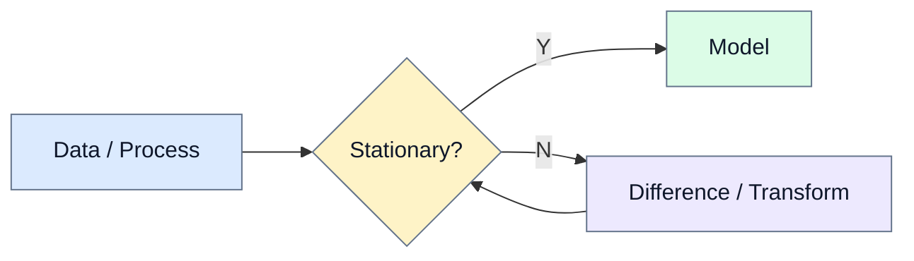

### Random Walk (R-W)

*(Behavior of stock prices)*

Suppose $\epsilon_t$ is a purely random series with mean $\mu$ and variance $\sigma^2$. Then the process $\{x_t\}$ is said to be a Random Walk if:

$$x_t = x_{t-1} + \epsilon_t$$

Let us assume $x_0 = 0$, then:

$$x_1 = \epsilon_1$$

$$x_2 = x_1 + \epsilon_2 = \epsilon_1 + \epsilon_2$$

$$\vdots$$

$$x_t = \sum_{i=1}^{t} \epsilon_i \implies E(x_t) = 0, \quad \text{Var}(x_t) = t\sigma^2$$

### Unit Root Derivation & Stationarity Tests

$$y_t = \alpha y_{t-1} + u_t$$

$$y_t - y_{t-1} = \alpha y_{t-1} - y_{t-1} + u_t$$

$$\Delta y_t = (\alpha - 1) y_{t-1} + u_t$$

$$\Delta y_t = \delta y_{t-1} + u_t$$

*(where $\delta = \alpha - 1$; if $\alpha = 1 \implies \delta = 0 \implies$ unit root)*

#### Testing for Stationarity:
1. Graphical
2. Correlogram
3. Dickey-Fuller Test

---

## 08/10/26

### ARIMA Model

* Stationary, Flexible
* It is a model method that helps us to understand complex data, predict future points, and is essentially part of the **BJ (Box-Jenkins)** approach.

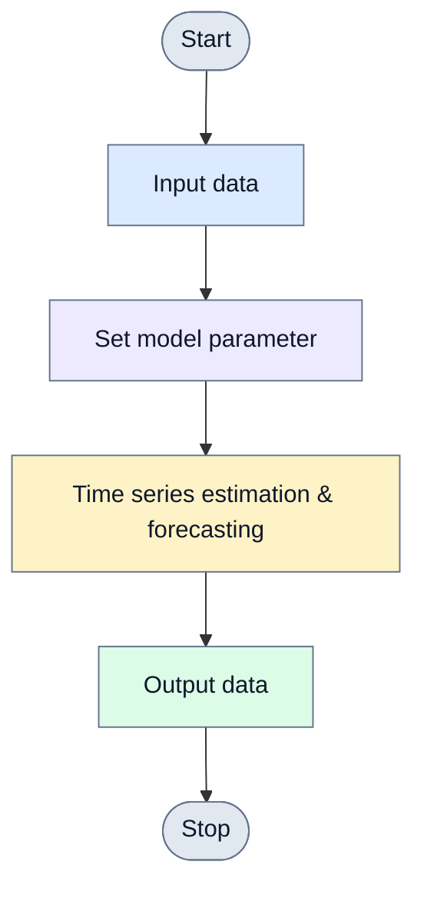

The general non-seasonal model is known as $\text{ARIMA}(p, d, q)$, where:
* $p =$ order of autoregressive part
* $d =$ degree of differencing involved
* $q =$ order of moving average part

This class of models is extended to non-stationary time series by allowing to difference the data.

### Box-Jenkins (BJ) Model

It is based on fitting an ARIMA model to a given set of data and then taking conditional expectation.

#### Steps:
* **a) Model identification:** Examine the data to see which model it fits to.
* **b) Estimation:** Estimate the model by least squares.
* **c) Diagnostic checking:** Examine the residuals from the model to see if it is adequate.
* **d) Consider alternative model:** Necessary if the model is inadequate; then choose another model.

BJ provides a general strategy of time series forecasting where the seasonal effect is largely removed.

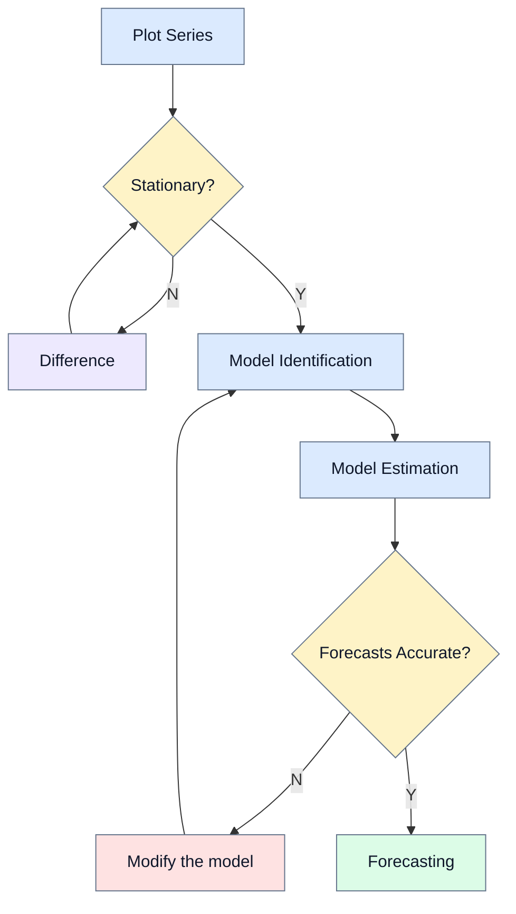

#### Differencing Example & Equation:

| $y_t$ | $\Delta y_t$ | $\Delta^2 y_t$ |
| :--- | :--- | :--- |
| $23$ | — | — |
| $25$ | $2$ | — |
| $27$ | $2$ | $0$ |
| $32$ | $5$ | $3$ |
| $33$ | $1$ | $-4$ |
| $31$ | $-2$ | $-3$ |
| $34$ | $3$ | $5$ |

$$\text{ARIMA}(1, 1, 2) \implies \Delta y_t = \alpha_0 + \alpha_1 \Delta y_{t-1} + \epsilon_{t-1} + \epsilon_{t-2} + \epsilon_t$$

---

## 13/10/26

### Correlogram

A **sample autocorrelation function** ($\text{SACF}$) has to be computed, for which sample covariance at lag $k$ and sample variance have to be computed.

* **Sample Covariance at lag $k$:**
  $$\gamma_k = \frac{\sum (y_t - \bar{y})(y_{t+k} - \bar{y})}{n}$$

* **Sample Variance ($\gamma_0$):**
  $$\gamma_0 = \frac{\sum (y_t - \bar{y})^2}{n}$$

* **Sample Autocorrelation Function ($\text{SACF}$):**
  $$\text{SACF}, k = \hat{\rho}_k = \frac{\gamma_k}{\gamma_0}$$

where $n =$ Sample Size.

If we plot $\hat{\rho}_k$ against $k$, it is a **sample correlogram**.

### White Noise

A sequence of random disturbances with $0$ mean and constant variance:

$$\text{Good forecast residuals} \implies \text{White noise}$$

To compute sample autocorrelation at lag $k$, $\text{SACF}(\hat{\rho}_k)$, compute sample covariance $\gamma_k$ (divided by $n-1$) and sample variance $\gamma_0$ (divided by $n-1$):

$$\gamma_k = \frac{\sum (y_t - \bar{y})(y_{t+k} - \bar{y})}{n - 1}$$

### ACF & PACF Graph and Behavior Table

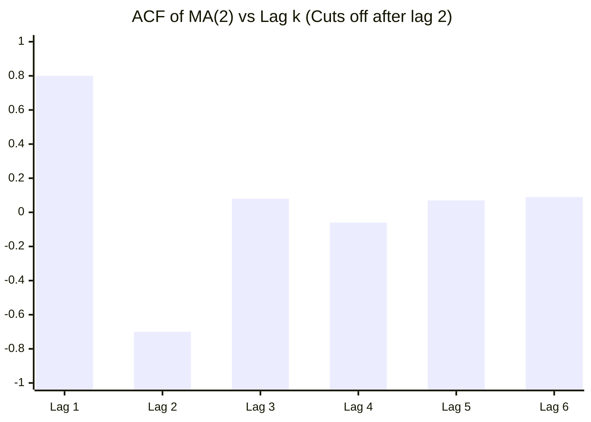

| Model | ACF | PACF |
| :--- | :--- | :--- |
| $\text{AR}(1)$ | Tails off | Cuts off after lag $1$ |
| $\text{AR}(2)$ | Tails off | Cuts off after lag $2$ |
| $\text{MA}(1)$ | Cuts off after lag $1$ | Tails off |
| $\text{MA}(2)$ | Cuts off after lag $2$ | Tails off |
| $\text{ARMA}(p, q)$ | Tails off | Tails off |

* $\text{AR}(2)$ **Model:**
  $$y_t = \alpha_0 - \alpha_1 y_{t-1} + \alpha_2 y_{t-2} + \epsilon_t$$

---

## 14/10/26

### Random Walk Without Drift

$$y_t = y_{t-1} + u_t$$

where $u_t$ is white noise with mean $0$ and variance $\sigma^2$: $u_t \sim N(0, \sigma^2)$.

$$y_1 = y_0 + u_1$$

$$y_2 = y_1 + u_2 = y_0 + u_1 + u_2$$

$$y_3 = y_2 + u_3 = y_0 + u_1 + u_2 + u_3$$

$$y_t = y_0 + \sum u_t$$

$$E(y_t) = E\left(y_0 + \sum u_t\right) = y_0$$

$$\text{Var}(y_t) = t\sigma^2$$

Hence RWM without drift is a **non-stationary** stochastic process. It can be written as:

$$y_t - y_{t-1} = u_t \implies \Delta y_t = u_t$$

Hence $y_t$ is non-stationary and $\Delta y_t$ is stationary. So the **first difference of RWM is stationary**.

### Random Walk With Drift

$$y_t = \gamma + y_{t-1} + u_t$$

*(where $\gamma =$ drift parameter)*

So:

$$y_t - y_{t-1} = \Delta y_t = \gamma + u_t$$

It drifts up or down depending on $\gamma$ being positive or negative:

$$E(y_t) = y_0 + t\gamma$$

$$\text{Var}(y_t) = t\sigma^2$$

### Markov First-Order AR Model

$$y_t = \rho y_{t-1} + u_t$$

* If $\rho = 1 \implies$ RW without drift, i.e., **Unit Root problem / non-stationary**.
* If $|\rho| < 1 \implies$ **Stationary**.

#### Tailing-Off Correlogram Patterns (ACF / PACF):

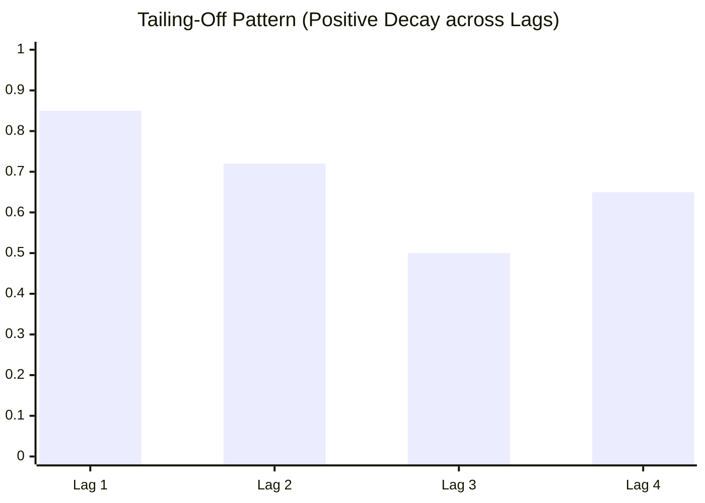

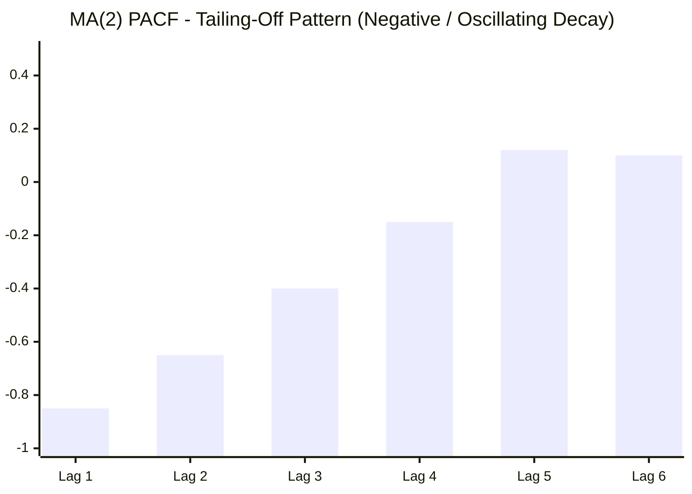

### Deterministic vs Stochastic Trend

* If trend is completely predictable $\implies$ **Deterministic trend**
* If trend is not predictable $\implies$ **Stochastic trend**

General equation:

$$y_t = \beta_1 + \beta_2 t + \beta_3 y_{t-1} + u_t$$

#### 1. Pure Random Walk (without drift):
* $\beta_1 = 0, \; \beta_2 = 0, \; \beta_3 = 1$
* $y_t = y_{t-1} + u_t$
* $\Delta y_t = (y_t - y_{t-1}) = u_t$

#### 2. Random Walk with Drift:
* $\beta_1 \ne 0, \; \beta_2 = 0, \; \beta_3 = 1$
* $y_t = \beta_1 + y_{t-1} + u_t$
* $(y_t - y_{t-1}) = \Delta y_t = \beta_1 + u_t$

#### 3. Deterministic Trend:
* $\beta_1 \ne 0, \; \beta_2 \ne 0, \; \beta_3 = 0$
* $y_t = \beta_1 + \beta_2 t + u_t$

#### 4. Random Walk with Drift & Deterministic Trend:
* $\beta_1 \ne 0, \; \beta_2 \ne 0, \; \beta_3 = 1$
* $y_t = \beta_1 + \beta_2 t + y_{t-1} + u_t$
* $\Delta y_t = \beta_1 + \beta_2 t + u_t$

---

## 20/10/26

### Information Criteria (SIC & AIC)

#### Schwarz Information Criterion (SIC):

$$\text{SIC} = n^{k/n} \frac{\sum \hat{u}_i^2}{n} = n^{k/n} \frac{\text{RSS}}{n}$$

$$\ln \text{SIC} = \frac{k}{n}\ln(n) + \ln\left(\frac{\text{RSS}}{n}\right)$$

* $\frac{k}{n}\ln(n) =$ penalty factor.
* Imposes a harsher penalty than AIC.
* Lower value of SIC is better. It can be used to compare in-sample or out-of-sample forecasting performance of a model.

#### Akaike Information Criterion (AIC):

$$\text{AIC} = e^{2k/n} \frac{\sum \hat{u}_i^2}{n} = e^{2k/n} \frac{\text{RSS}}{n}$$

$$\ln \text{AIC} = \left(\frac{2k}{n}\right) + \ln\left(\frac{\text{RSS}}{n}\right)$$

* $\frac{2k}{n} =$ penalty factor.
* $k \rightarrow$ no. of exogenous variables (parameters)
* $n \rightarrow$ no. of observations
* Compare 2 models: **Model with lower AIC is preferred**.

#### Model Specifications:
1. $y_t = \alpha_0 + \alpha_1 x_t + u_t$ *(with constant)*
2. $y_t = \alpha_1 x_t + u_t$ *(without constant)*
3. $y_t = \alpha_0 + \alpha_1 x_t + \alpha_2 t + u_t$ *(with trend & constant)*
4. $y_t = \alpha_1 x_t + \alpha_2 t + u_t$ *(with trend, no constant)*

---

## 21/10/26

### Box-Jenkins (BJ) Method

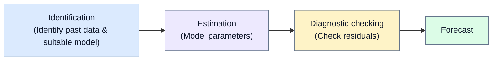

#### Differencing Table:

| $y_t$ | $\Delta y_t$ | $\Delta^2 y_t$ |
| :--- | :--- | :--- |
| $1100$ | — | — |
| $1120$ | $20$ | — |
| $1133$ | $13$ | $-7$ |
| $1149$ | $16$ | $3$ |
| $1150$ | $1$ | $-15$ |

* **Uses:**
  $$y_t = \alpha_0 + \alpha_1 y_{t-1} + \epsilon_t$$

### Correlogram Graphs ($\text{AR}(1)$ vs $\text{MA}(2)$)

#### 1. $\text{AR}(1)$ Model: $y_t = \alpha_0 + \alpha_1 y_{t-1} + \epsilon_t$

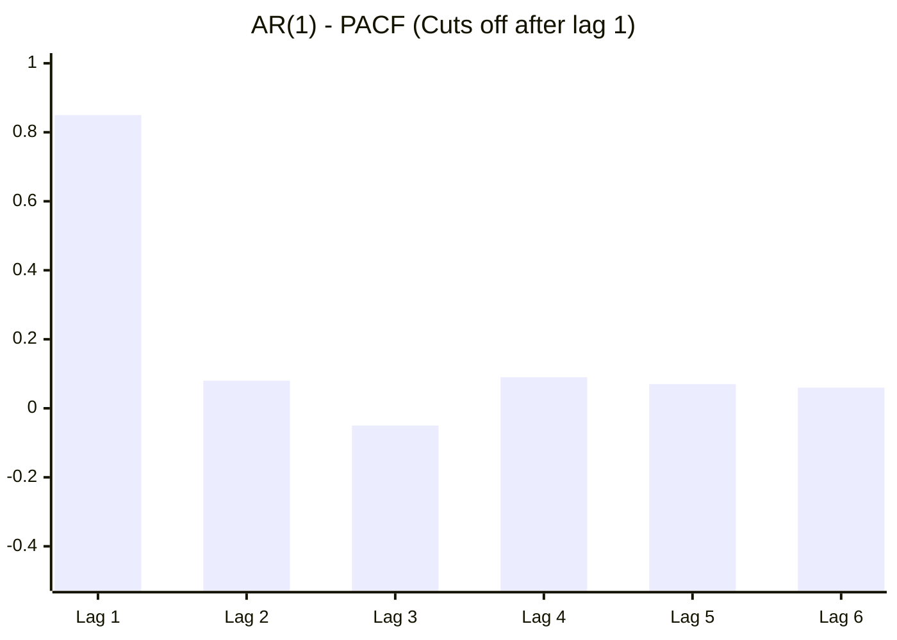

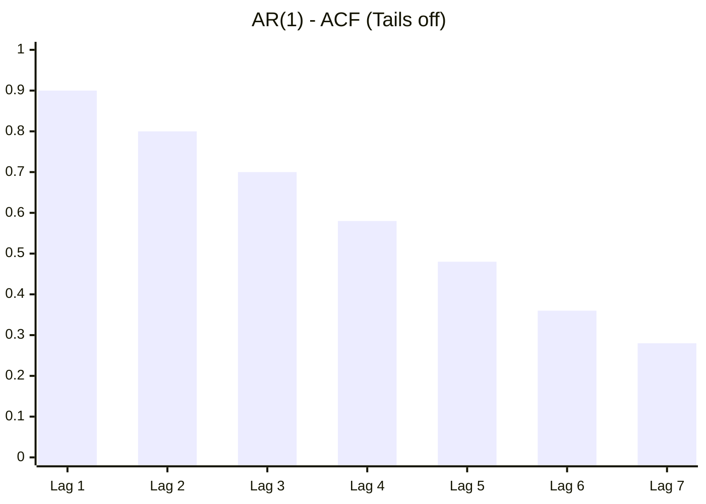

#### 2. $\text{MA}(2)$ Model: $y_t = \alpha_0 + \alpha_1 \epsilon_{t-1} - \alpha_2 \epsilon_{t-2} + \epsilon_t$

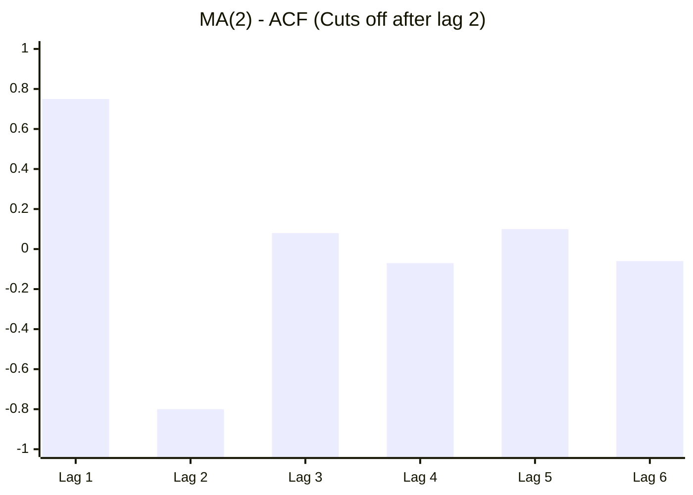

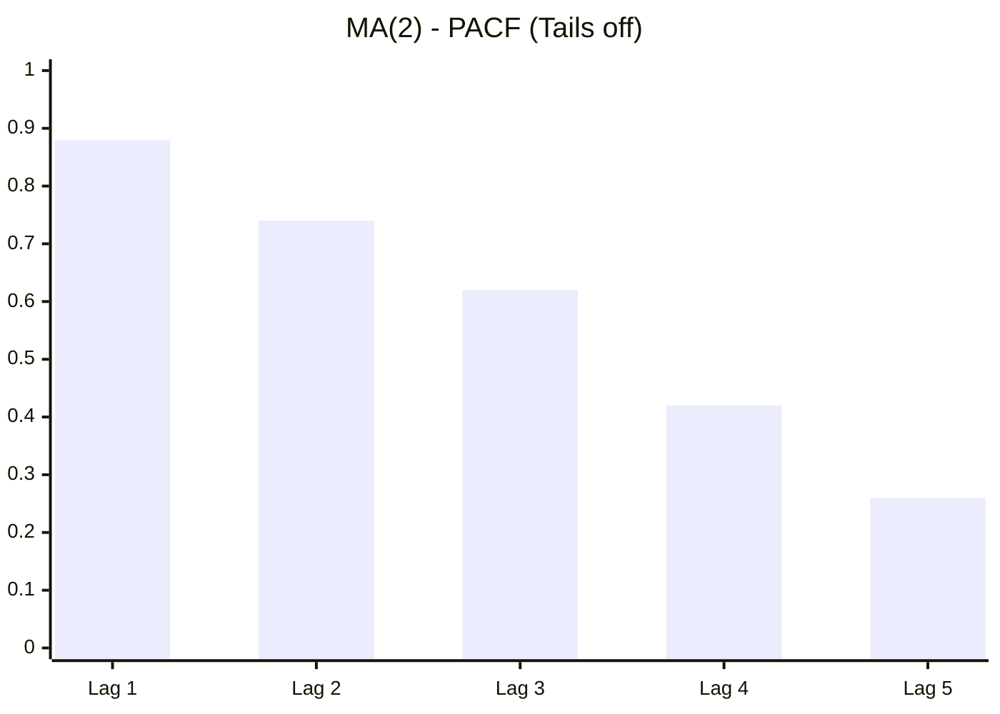

---

## 22/10/26

### Stationarity & Random Walk Equations

1. **Random walk without constant / without drift:**
   $$y_t = y_{t-1} + \epsilon_t, \quad \epsilon_t \sim N(0, \sigma^2)$$
   $$y_t - y_{t-1} = \epsilon_t \implies \Delta y_t = \epsilon_t$$

2. **With trend & constant:**
   $$y_t = \alpha_0 + \alpha_1 y_{t-1} + \alpha_2 t + u_t$$

3. **With constant:**
   $$y_t = \alpha_0 + \alpha_1 y_{t-1} + u_t$$

4. **Without constant & without trend:**
   $$y_t = \alpha_1 y_{t-1} + u_t$$

5. **With trend (no constant):**
   $$y_t = \alpha_1 y_{t-1} + \alpha_2 t + u_t$$

> **Note:** $|\rho| = 1 \implies$ Non-stationarity (Unit root problem).

---

## 23/10/26

### ARMA & ARIMA Equations

* $\text{ARMA}(1, 1) = \text{ARIMA}(1, 0, 1)$**:**
  $$y_t = \alpha_0 + \alpha_1 y_{t-1} + \alpha_2 \epsilon_{t-1} + \epsilon_t$$

* $\text{ARIMA}(1, 1, 0)$**:**
  $$\Delta y_t = \alpha_0 + \alpha_1 \Delta y_{t-1} + \epsilon_t$$

* $\text{ARIMA}(0, 1, 1)$**:**
  $$\Delta y_t = \alpha_0 + \alpha_1 \epsilon_{t-1} + \epsilon_t$$

* $\text{ARIMA}(0, 0, 1)$**:**
  $$y_t = \alpha_0 + \alpha_1 \epsilon_{t-1} + u_t$$

### Dickey-Fuller Test & Unit Root Derivation

* Null Hypothesis: $H_0: \delta = 0$
* Authors have computed critical $\tau$ (Tau) statistics on the basis of Monte Carlo simulation.
* If $H_0$ is rejected $\implies$ series is **stationary**.

#### Derivation:

$$y_t = \beta_1 + \beta_2 t + \beta_3 y_{t-1} + u_t$$

For pure RW ($\beta_1 = 0, \beta_2 = 0, \beta_3 = 1$):

$$y_t = \rho y_{t-1} + \epsilon_t, \quad -1 \le \rho \le +1$$

*(where $\epsilon_t$ is white noise. We should not regress $y_t$ on $y_{t-1}$ directly).*

Subtract $y_{t-1}$ from both sides:

$$y_t - y_{t-1} = \rho y_{t-1} - y_{t-1} + \epsilon_t$$

$$\Delta y_t = (\rho - 1) y_{t-1} + \epsilon_t$$

$$\Delta y_t = \delta y_{t-1} + \epsilon_t$$

* Null Hypothesis: $H_0: \delta = 0$
* When $\rho = 1 \implies \delta = 0 \implies \Delta y_t = \epsilon_t$ *(Stationary)*.

---

## 27/10/26

### ARIMA Properties

* It is an **iterative process**.
* It is a **Box-Jenkins model**.
* Checking whether it is stationary or non-stationary using the level of integration $I(d)$.
* Superior to exponential smoothing method.
* Used for data sample greater than $50$ ($n > 50$).
* Provides a perfect fit for historical data.

### Unit Root Condition

$$y_t = \delta y_{t-1} + \epsilon_t$$

$$y_t - y_{t-1} = \delta y_{t-1} - y_{t-1} + \epsilon_t$$

$$\Delta y_t = (\delta - 1) y_{t-1} + \epsilon_t$$

$$\Delta y_t = \gamma y_{t-1} + \epsilon_t$$

* Range of $\delta$: $-1 \longleftrightarrow 0 \longleftrightarrow +1$. If $\delta = 1 \implies$ unit root, RW, non-stationary.
* If $\gamma = 0 \implies$ there is a unit root (time series is **non-stationary**).
* If $\gamma < 0 \implies$ time series is **stationary**.

### Dickey-Fuller Test Cases

1. **Case 1 (No intercept & no trend):**
   $$y_t = y_{t-1} + \epsilon_t \implies \Delta y_t = \epsilon_t$$
   *(Difference Stationary Process)*

2. **Case 2 (With intercept / drift):**
   $$y_t = \beta_1 + y_{t-1} + \epsilon_t \implies \Delta y_t = \beta_1 + \epsilon_t$$
   *(Stochastic trend)*

3. **Case 3 (Trend Stationary Process):**
   $$y_t = \beta_1 + \beta_2 t + \epsilon_t \implies \Delta y_t = \beta_2 + \Delta \epsilon_t$$
   *(Trend Stationary Process)*

4. **Case 4 (With drift & trend):**
   $$y_t = \beta_1 + \beta_2 t + y_{t-1} + \epsilon_t \implies \Delta y_t = \beta_1 + \beta_2 t + \epsilon_t$$

5. **Case 5 ($\text{AR}(1)$ with trend):**
   $$y_t = \beta_1 + \beta_2 t + \rho y_{t-1} + \epsilon_t$$
   *(Trend Stationary Process when $|\rho| < 1$)*

### Stationarity Diagnostic Flowchart

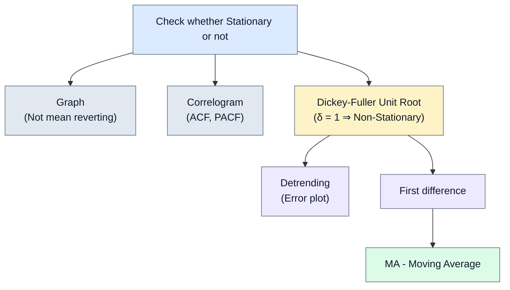

### ARIMA BJ-Method Pipeline

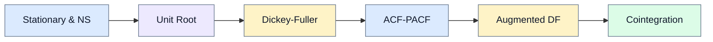

### 3 Specifications of Dickey-Fuller Testing

1. $y_t$ **is a RW:**
   $$\Delta y_t = \delta y_{t-1} + \epsilon_t$$

2. $y_t$ **is RW with drift:**
   $$\Delta y_t = \beta_0 + \delta y_{t-1} + \epsilon_t$$

3. $y_t$ **is RW with trend & drift:**
   $$\Delta y_t = \beta_0 + \beta_1 t + \delta y_{t-1} + \epsilon_t$$

where $\epsilon_t$ is white noise.

* $H_0: \delta = 0$ i.e. $y_t$ is **non-stationary**.
* $H_1: \delta < 0$ i.e. $y_t$ is **stationary**.
* If $H_0$ is rejected, $y_t$ is stationary ($\tau$-test statistics: if computed $\tau$ value is smaller / more negative than critical $\tau$, reject $H_0$).

### DF vs ADF vs Phillips-Perron (PP)

* **DF:** Assumes $\epsilon_t$ is white noise.
  $$\Delta y_t = \delta y_{t-1} + \epsilon_t \implies \Delta y_t = f(y_{t-1})$$

* **ADF (Augmented Dickey-Fuller):** If $\epsilon_t$ is serially correlated, add lagged difference terms:
  $$\Delta y_t = f(y_{t-1}, \Delta y_{t-1}, \dots)$$
  *(AIC / SIC / BIC are used for selecting optimal lag length).*

* **Phillips-Perron (PP) Unit Root Test:**
  PP uses **non-parametric statistical methods** to take care of serial correlation in the error term without adding lagged difference terms.

### Order of Integration $I(d)$

* $I(0)$**:** Stationary at level
* $I(1)$**:** 1st difference $\implies \Delta y_t = (y_t - y_{t-1})$
* $I(2)$**:** 2nd difference $\implies \Delta^2 y_t = (\Delta y_t - \Delta y_{t-1})$
* $I(3)$**:** 3rd difference

> **Note:** We should use the same order of differencing for both features, even if one of the data series gets stationary before the other one.

---

## 29/10/26

### Cointegration

$$y_t = \alpha_0 + \alpha_1 x_t + u_t$$

$$\Delta y_t = \alpha_0 + \alpha_1 \Delta x_{t-1} + u_{t-1}$$

* **Cointegration** means a **long-run relationship**.
* Two series share the same common trend.
* Two variables are cointegrated if they have a **long-term equilibrium relationship** between them.
* If the distance between two variables is constant / stationary, $y_t$ and $x_t$ are cointegrated.
* Two $I(1)$ series are cointegrated if there exists at least one linear combination of these variables that is $I(0)$ (stationary).
* **Engle-Granger (EG) Test:** A test for cointegration — can be thought of as a pre-test to avoid **Spurious Regression** situations:
  $$y_t = \alpha_0 + \alpha_1 x_t + u_t$$

### DF & ADF on Residuals

* **DF:**
  $$\Delta y_t = \alpha_0 + \alpha_1 y_{t-1} + \epsilon_t$$

* **ADF** *(if the white noise is correlated)*:
  $$\Delta y_t = \alpha_0 + \alpha_1 y_{t-1} + \alpha_2 \Delta y_{t-1} + \epsilon_t$$

### Error-Correction Model (ECM)

$$\Delta \epsilon_t = f(\hat{\epsilon}_{t-1}) \quad \text{or} \quad \Delta y_t = \alpha_0 + \alpha_1 \Delta x_t + \gamma \hat{u}_{t-1} + \epsilon_t$$

### Granger Causality Model

$$y_t = f(y_{t-1}, x_{t-1})$$

$$x_t = f(y_{t-1}, x_{t-1})$$

### Vector Autoregressive Model (VAR)

Mutual relationship between variables:

$$y_t = f(x_{t-1}, y_{t-1}, z_{t-1})$$

$$x_t = f(x_{t-1}, y_{t-1}, z_{t-1})$$

$$z_t = f(x_{t-1}, y_{t-1}, z_{t-1})$$

> **Note:** No correlation between error terms.

---

## 02/11/26

### ARCH($p$) & GARCH Models

* Yesterday's unexpected news influences today's volatility.
* Large price movements tend to be followed by large movements, and small movements tend to be followed by small movements.
* Return affects investment:
  * Sunday: $100$
  * Monday: $110 \implies \frac{110 - 100}{100} = 10\%$

#### ARCH(1) / ARMA(1, 0, 0):

$$\sigma_t^2 = \alpha_0 + \alpha_1 \epsilon_{t-1}^2$$

$$\hat{\epsilon}_t^2 = \alpha_0 + \alpha_1 \hat{\epsilon}_{t-1}^2 + v_t$$

#### Notes:
* **Volatility clustering** $\implies$ ARCH model.
* Variance is a function of lagged $\epsilon^2$.
* If $\alpha_1$ is $+ve$ (today's variance depends on previous high squared error) $\implies$ there is **volatility clustering**.
* If $\alpha_1 = 0 \implies$ **No volatility clustering**.

#### ARCH vs GARCH:
* **ARCH Model:** $\text{Var}_t = f(\text{lag } \epsilon^2)$
* **GARCH Model:** $\text{Var}_t = f(\text{lag } \epsilon^2, \; \text{lag } \text{Var}_{t-1})$
* Both models are used for **volatility clustering**.