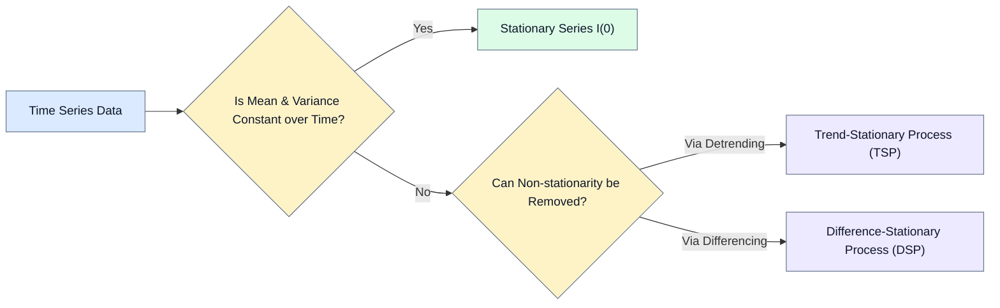
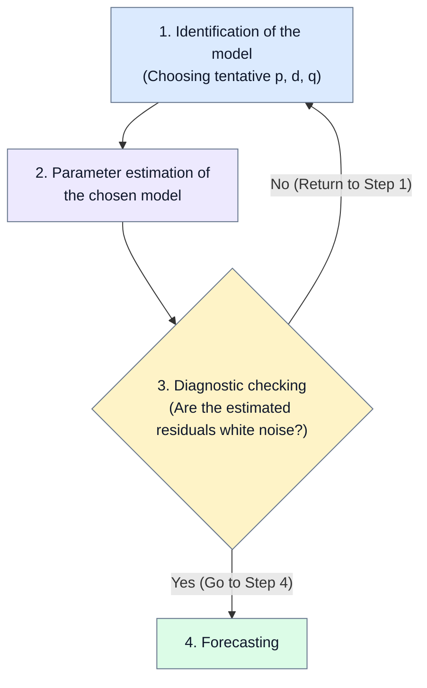
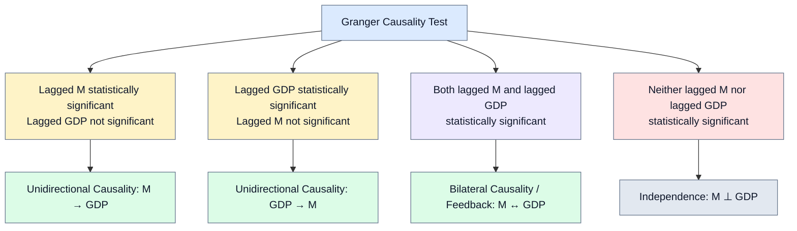
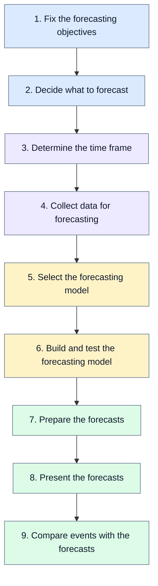

# TS UNIT 3: Time Series Models, Stationarity & Forecasting

## 1. Fundamentals of Stationarity

### 1.1 Stationary Stochastic Process

A stochastic process is said to be **stationary** (specifically *weakly stationary*, *covariance stationary*, *second-order stationary*, or *wide-sense stationary*) if its mean and variance are constant over time and the value of covariance between two time periods depends only on the distance, gap, or lag between the two periods, and not on the actual time at which the covariance is computed.

* **Mean:**

$$
E(Y_t) = \mu
$$

* **Variance:**

$$
\operatorname{var}(Y_t) = E(Y_t - \mu)^2 = \sigma^2
$$

* **Covariance (Autocovariance at lag $k$):**

$$
\gamma_k = E[(Y_t - \mu)(Y_{t+k} - \mu)]
$$

Where:
* $\gamma_k$ is the covariance between values of $Y_t$ and $Y_{t+k}$ that are $k$ periods apart.
* If $k = 0$, $\gamma_0 = \operatorname{var}(Y_t) = \sigma^2$.
* If $k = 1$, $\gamma_1$ is the covariance between two adjacent values of $Y$.

A stationary time series exhibits **mean reversion** (it tends to return to its long-term mean), and its fluctuations around the mean have broadly constant amplitude. If a time series does not meet these criteria (possessing a time-varying mean, time-varying variance, or both), it is **non-stationary**.

### 1.2 Purely Random / White Noise Process

A stochastic process is purely random or **white noise** ($\epsilon_t$ or $u_t$) if:
* It has a zero mean: $E(u_t) = 0$
* It has constant variance: $\operatorname{var}(u_t) = \sigma^2$
* It is serially uncorrelated: $\gamma_k = 0$ for all $k \ne 0$

---

## 2. Trend-Stationary (TSP) vs. Difference-Stationary (DSP) Processes

### 2.1 Trend-Stationary Process (TSP)

A trend-stationary time series has a deterministic trend over time, but its fluctuations around that trend are stationary (the ups and downs remain stable):

$$
Y_t = \alpha + \beta t + u_t
$$

* **Mean:** $E(Y_t) = \alpha + \beta t$ (time-dependent, but perfectly predictable once $\alpha$ and $\beta$ are known).
* **Variance:** $\operatorname{var}(Y_t) = \sigma^2$ (constant).

#### Detrending (Making TSP Stationary):
Remove the deterministic trend by subtracting the trend line from the series rather than taking first differences:

$$
Y_t - (\alpha + \beta t) = u_t
$$

#### Numerical Example:

| Year | Trend | Sales ($Y_t$) | Residual ($u_t = Y_t - \text{Trend}$) |
| :--- | :--- | :--- | :--- |
| 2021 | 100 | 102 | $+2$ |
| 2022 | 110 | 108 | $-2$ |
| 2023 | 120 | 122 | $+2$ |
| 2024 | 130 | 128 | $-2$ |
| 2025 | 140 | 141 | $+1$ |

---

## 3. The Random Walk Model (RWM) & The 5 General Cases

Consider the general equation:

$$
Y_t = \beta_1 + \beta_2 t + \beta_3 Y_{t-1} + u_t \quad \text{--- Eq. (1)}
$$

where $u_t$ is a white noise error term and $t$ is time measured chronologically.

### Case 1: Pure Random Walk (Without Drift)

$$
\beta_1 = 0, \quad \beta_2 = 0, \quad \beta_3 = 1
$$

$$
Y_t = Y_{t-1} + u_t \quad \text{--- Eq. (2)}
$$

* Non-stationary in levels.
* First difference is stationary:

$$
\Delta Y_t = (Y_t - Y_{t-1}) = u_t \quad \text{--- Eq. (3)}
$$

* Hence, a RWM without drift is a **Difference-Stationary Process (DSP)**.

### Case 2: Random Walk with Drift

$$
\beta_1 \ne 0, \quad \beta_2 = 0, \quad \beta_3 = 1
$$

$$
Y_t = \beta_1 + Y_{t-1} + u_t \quad \text{--- Eq. (4)}
$$

$$
\Delta Y_t = (Y_t - Y_{t-1}) = \beta_1 + u_t \quad \text{--- Eq. (3a)}
$$

* $\beta_1$ is the drift parameter.
* If $\beta_1 > 0$, the series exhibits a positive trend; if $\beta_1 < 0$, it exhibits a negative trend (**stochastic trend**).
* It is a **DSP** because the non-stationarity in $Y_t$ is eliminated by taking first differences.

### Case 3: Deterministic Trend

$$
\beta_1 \ne 0, \quad \beta_2 \ne 0, \quad \beta_3 = 0
$$

$$
Y_t = \beta_1 + \beta_2 t + u_t \quad \text{--- Eq. (4)}
$$

* Known as a **Trend-Stationary Process (TSP)**.
* Mean is $\beta_1 + \beta_2 t$, variance is constant ($\sigma^2$).
* Series becomes stationary by subtracting the mean $\beta_1 + \beta_2 t$ (detrending).

### Case 4: Random Walk with Drift and Deterministic Trend

$$
\beta_1 \ne 0, \quad \beta_2 \ne 0, \quad \beta_3 = 1
$$

$$
Y_t = \beta_1 + \beta_2 t + Y_{t-1} + u_t \quad \text{--- Eq. (5)}
$$

$$
\Delta Y_t = \beta_1 + \beta_2 t + u_t \quad \text{--- Eq. (5a)}
$$

* Contains both a drift and a deterministic trend; non-stationary.

### Case 5: Deterministic Trend with Stationary AR(1) Component

$$
\beta_1 \ne 0, \quad \beta_2 \ne 0, \quad \vert\beta_3\vert < 1
$$

$$
Y_t = \beta_1 + \beta_2 t + \beta_3 Y_{t-1} + u_t \quad \text{--- Eq. (6)}
$$

* Stationary around the deterministic trend line.

---

## 4. Order of Integration $I(d)$

* If a non-stationary time series has to be differenced $d$ times to make it stationary, it is integrated of order $d$:

$$
Y_t \sim I(d)
$$

* If a series is stationary to begin with ($d = 0$):

$$
Y_t \sim I(0)
$$

* Most economic time series are $I(1)$ (they achieve stationarity after taking first differences).

---

## 5. Autocorrelation Function (ACF) & Partial Autocorrelation (PACF)

### 5.1 Mathematical Formulations

The theoretical Autocorrelation Function (ACF) at lag $k$ is:

$$
\rho_k = \frac{\gamma_k}{\gamma_0} = \frac{\operatorname{cov}(Y_t, Y_{t+k})}{\operatorname{var}(Y_t)}
$$

* $\rho_k$ is a unitless ratio between $-1$ and $+1$.
* A plot of $\rho_k$ against $k$ is the **population correlogram**.

The **Sample Autocorrelation Function (SACF)** $\hat{\rho}_k$ uses sample covariance and sample variance:

$$
\hat{\gamma}_k = \frac{\sum (Y_t - \bar{Y})(Y_{t+k} - \bar{Y})}{n}
$$

$$
\hat{\gamma}_0 = \frac{\sum (Y_t - \bar{Y})^2}{n}
$$

$$
\hat{\rho}_k = \frac{\hat{\gamma}_k}{\hat{\gamma}_0}
$$

* A plot of $\hat{\rho}_k$ against $k$ is the **sample correlogram**.

### 5.2 Theoretical Patterns of ACF and PACF

| Type of Model | Typical Pattern of ACF | Typical Pattern of PACF |
| :--- | :--- | :--- |
| $\text{AR}(p)$ | Decays exponentially or with damped sine wave pattern or both | Significant spikes through lags $p$, cuts off after lag $p$ |
| $\text{MA}(q)$ | Significant spikes through lags $q$, cuts off after lag $q$ | Declines exponentially |
| $\text{ARMA}(p, q)$ | Exponential decay | Exponential decay |

---

## 6. ARMA & ARIMA Modeling

### 6.1 Autoregressive $\text{AR}(p)$ Model

Values are described by linear models based on preceding observations:

$$
x(t) = \sum_{i=1}^{p} \alpha_i x(t-i) + u_t
$$

### 6.2 Moving Average $\text{MA}(q)$ Model

Values are expressed as dependent on preceding estimation errors:

$$
x(t) = u_t - \sum_{i=1}^{q} \beta_i \varepsilon(t-i)
$$

### 6.3 $\text{ARMA}(p, q)$ Model

Combines both autoregressive and moving average dynamics:

$$
x(t) = \sum_{i=1}^{p} \alpha_i x(t-i) - \sum_{i=1}^{q} \beta_i \varepsilon(t-i) + u_t
$$

$\text{ARMA}(1, 1)$ formulation:

$$
Y_t = \theta + \alpha_1 Y_{t-1} + \beta_0 u_t + \beta_1 u_{t-1}
$$

### 6.4 $\text{ARIMA}(p, d, q)$ Model

When trend filtering / differencing is required:
* $p =$ order of the auto-regressive part
* $d =$ number of differentiation steps until stationary
* $q =$ order of the moving average part

#### Special Identifications:
* $\text{ARIMA}(p, 0, 0) \equiv \text{purely AR}(p)$ stationary process
* $\text{ARIMA}(0, 0, q) \equiv \text{purely MA}(q)$ stationary process
* $\text{ARIMA}(p, 0, q) \equiv \text{ARMA}(p, q)$ stationary process
* $\text{ARIMA}(2, 1, 1)$: Uses last 2 months' sales, differences the data once, and adjusts with the last error.

---

## 7. The Box-Jenkins (BJ) Methodology

A mathematical modeling framework designed to forecast time series data by transforming it into a stationary series via differences.

### 7.1 Four Core Steps of BJ Methodology

### 7.2 Six Implementation Steps

```mermaid
flowchart LR
    M1["1. Data collection"] --> M2["2. Check for data stationarity"]
    M2 --> M3["3. Determine ACF and PACF values<br/>(p and q, respectively)"]
    M3 --> M4["4. Train the ARIMA model"]
    M4 --> M5["5. Forecast using the model<br/>for future periods"]
    M5 --> M6["6. Compare the actual values<br/>vs forecasted values"]

    style M1 fill:#dbeafe,stroke:#64748b,color:#0f172a
    style M2 fill:#fef3c7,stroke:#64748b,color:#0f172a
    style M3 fill:#ede9fe,stroke:#64748b,color:#0f172a
    style M4 fill:#dbeafe,stroke:#64748b,color:#0f172a
    style M5 fill:#ede9fe,stroke:#64748b,color:#0f172a
    style M6 fill:#dcfce7,stroke:#64748b,color:#0f172a
```

---

## 8. Case Study: Gold Price Forecasting (1990–91 to 2018–19)

### 8.1 Historical Data

Annual prices of gold (Rs per 10 grams):

| YEAR | GOLD | YEAR | GOLD |
| :--- | :--- | :--- | :--- |
| 1990-91 | 3451.52 | 2005-06 | 6900.56 |
| 1991-92 | 4297.63 | 2006-07 | 9240.32 |
| 1992-93 | 4103.66 | 2007-08 | 9995.62 |
| 1993-94 | 4531.87 | 2008-09 | 12889.74 |
| 1994-95 | 4667.24 | 2009-10 | 15756.09 |
| 1995-96 | 4957.60 | 2010-11 | 19227.08 |
| 1996-97 | 5070.71 | 2011-12 | 25722.42 |
| 1997-98 | 4347.07 | 2012-13 | 30163.93 |
| 1998-99 | 4268.17 | 2013-14 | 29190.39 |
| 1999-00 | 4393.56 | 2014-15 | 27414.55 |
| 2000-01 | 4473.60 | 2015-16 | 26534.26 |
| 2001-02 | 4579.12 | 2016-17 | 29665.28 |
| 2002-03 | 5332.36 | 2017-18 | 29300.08 |
| 2003-04 | 5718.95 | 2018-19 | 31193.41 |
| 2004-05 | 6145.38 | | |

### 8.2 Model Selection and Identification

* The PACF of the differenced gold price series exhibits a significant spike at lag 1 and drops inside the $95\%$ confidence bounds for subsequent lags.
* Model selected: $\text{ARIMA}(1, 1, 0)$ **with drift**.

---

## 9. Unit Root Tests: Dickey-Fuller (DF) & Augmented Dickey-Fuller (ADF)

Starting with the Markov first-order model:

$$
Y_t = \rho Y_{t-1} + u_t \quad (-1 \le \rho \le 1)
$$

Subtract $Y_{t-1}$ from both sides:

$$
Y_t - Y_{t-1} = \rho Y_{t-1} - Y_{t-1} + u_t
$$

$$
\Delta Y_t = (\rho - 1)Y_{t-1} + u_t
$$

$$
\Delta Y_t = \delta Y_{t-1} + u_t
$$

where $\delta = (\rho - 1)$.

* **Hypotheses:**
  * $H_0: \delta = 0 \iff \rho = 1$ (Unit root exists $\implies$ Non-stationary)
  * $H_1: \delta < 0 \iff \rho < 1$ (Stationary)

### 9.1 Three Specifications of Dickey-Fuller (DF)

1. $Y_t$ **is a random walk:**

$$
\Delta Y_t = \delta Y_{t-1} + u_t
$$

2. $Y_t$ **is a random walk with drift:**

$$
\Delta Y_t = \beta_1 + \delta Y_{t-1} + u_t
$$

3. $Y_t$ **is a random walk with drift around a stochastic / deterministic trend:**

$$
\Delta Y_t = \beta_1 + \beta_2 t + \delta Y_{t-1} + u_t
$$

The test statistic follows the $\tau$ **(tau) statistic** (critical values calculated via Monte Carlo simulations). If computed $\tau < \tau_{\text{critical}}$ (more negative), reject $H_0 \implies$ stationary.

### 9.2 Augmented Dickey-Fuller (ADF) Test

When error terms $u_t$ are correlated, add lagged values of the dependent variable $\Delta Y_t$:

$$
\Delta Y_t = \beta_1 + \beta_2 t + \delta Y_{t-1} + \sum_{i=1}^{m} \alpha_i \Delta Y_{t-i} + \varepsilon_t
$$

---

## 10. Cointegration: Regression of a Unit Root Series on Another

Regressing a non-stationary time series on another non-stationary series typically produces a **spurious regression**.

### 10.1 Concept

Suppose $Y_t \sim I(1)$ and $X_t \sim I(1)$:

$$
Y_t = \beta_1 + \beta_2 X_t + u_t
$$

$$
u_t = Y_t - \beta_1 - \beta_2 X_t
$$

If the linear combination cancels out the stochastic trends such that residuals are stationary:

$$
u_t \sim I(0)
$$

Then $Y_t$ and $X_t$ are **cointegrated**.
* Economically, they share a **long-term equilibrium relationship**.
* $\beta_2$ is the **cointegrating parameter**.
* "A test for cointegration can be thought of as a pre-test to avoid 'spurious regression' situations" (Granger).

### 10.2 Testing for Cointegration
* **Engle-Granger (EG) or Augmented Engle-Granger (AEG) Test:** Run the cointegrating regression, obtain residuals $\hat{u}_t$, and subject them to unit root tests:

$$
\Delta \hat{u}_t = \delta \hat{u}_{t-1} + \sum_{i=1}^{m} \alpha_i \Delta \hat{u}_{t-i} + \varepsilon_t
$$

---

## 11. Granger Causality Test

Since the future cannot predict the past, if variable $X$ (Granger) causes variable $Y$, then changes in $X$ should precede changes in $Y$.

### 11.1 Bilateral Regressions

$$
\operatorname{GDP}_t = \sum_{i=1}^{n} \alpha_i M_{t-i} + \sum_{j=1}^{n} \beta_j \operatorname{GDP}_{t-j} + u_{1t} \quad \text{--- Eq. (1)}
$$

$$
M_t = \sum_{i=1}^{n} \lambda_i M_{t-i} + \sum_{j=1}^{n} \delta_j \operatorname{GDP}_{t-j} + u_{2t} \quad \text{--- Eq. (2)}
$$

where disturbances $u_{1t}$ and $u_{2t}$ are assumed uncorrelated.

### 11.2 Four Causality Outcomes

### 11.3 Implementation Steps & $F$-Test

1. Regress current $X$ on all lagged $X$ terms without lagged $Y$ (**restricted regression**); obtain $RSS_R$.
2. Run the regression including lagged $Y$ terms (**unrestricted regression**); obtain $RSS_{UR}$.
3. Set null hypothesis: $H_0: \alpha_i = 0$ ($i = 1, 2, \dots, n$, lagged $Y$ terms do not belong).
4. Apply the $F$-test:

$$
F = \frac{(RSS_R - RSS_{UR})/m}{RSS_{UR}/(n - k)}
$$

which follows the $F$-distribution with $m$ and $(n - k)$ degrees of freedom ($m =$ number of lagged $Y$ terms, $k =$ number of parameters estimated in unrestricted regression).
5. If computed $F > F_{\text{critical}}$, reject $H_0 \implies Y$ Granger-causes $X$.
6. Repeat for the reverse model to check if $X$ Granger-causes $Y$.

---

## 12. Vector Autoregression (VAR)

Multivariable causality extended to a system of simultaneous equations. For a 3-variable system ($X_t, Y_t, Z_t$):

$$
X_t = \alpha + \sum_{j=1}^{k} \beta_j X_{t-j} + \sum_{j=1}^{k} \gamma_j Y_{t-j} + \sum_{j=1}^{k} \delta_j Z_{t-j} + u_{1t}
$$

$$
Y_t = \alpha' + \sum_{j=1}^{k} \theta_j X_{t-j} + \sum_{j=1}^{k} \gamma_j Y_{t-j} + \sum_{j=1}^{k} \lambda_j Z_{t-j} + u_{2t}
$$

$$
Z_t = \alpha'' + \sum_{j=1}^{k} \phi_j X_{t-j} + \sum_{j=1}^{k} \psi_j Y_{t-j} + \sum_{j=1}^{k} \omega_j Z_{t-j} + u_{3t}
$$

---

## 13. Forecasting Overview & 9-Step Process

### 13.1 Qualitative vs. Quantitative Forecasting

* **Qualitative Forecasting:** Subjective, based on opinion and judgment of consumers/experts (e.g., Delphi method). Applied to long-range decisions when past data is unavailable.
* **Quantitative Forecasting:** Mathematical models forecasting future data as a function of past numerical data (e.g., moving averages, simple exponential smoothing, double exponential smoothing, ARIMA, neural networks). Applied to short- or intermediate-range decisions.

### 13.2 The 9 Steps of the Forecasting Workflow

